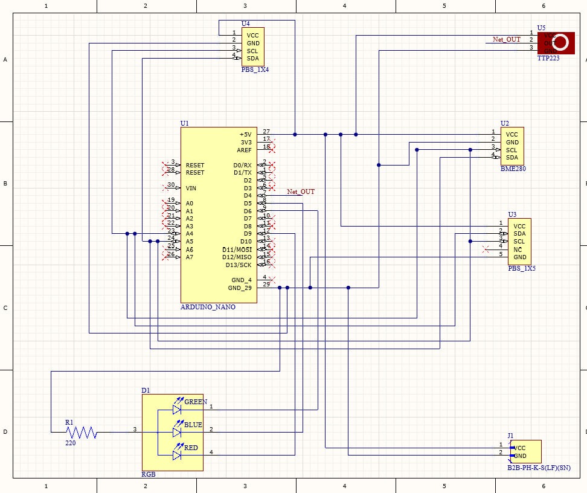
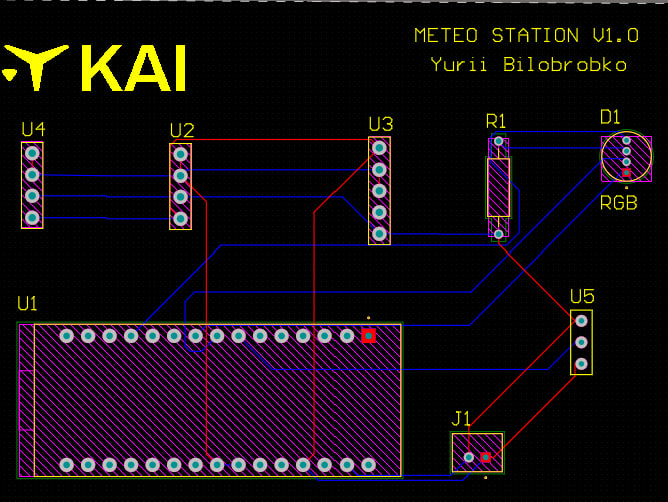
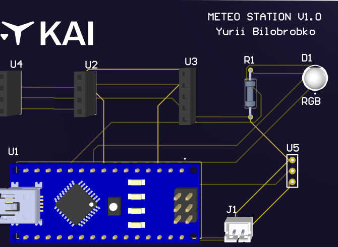
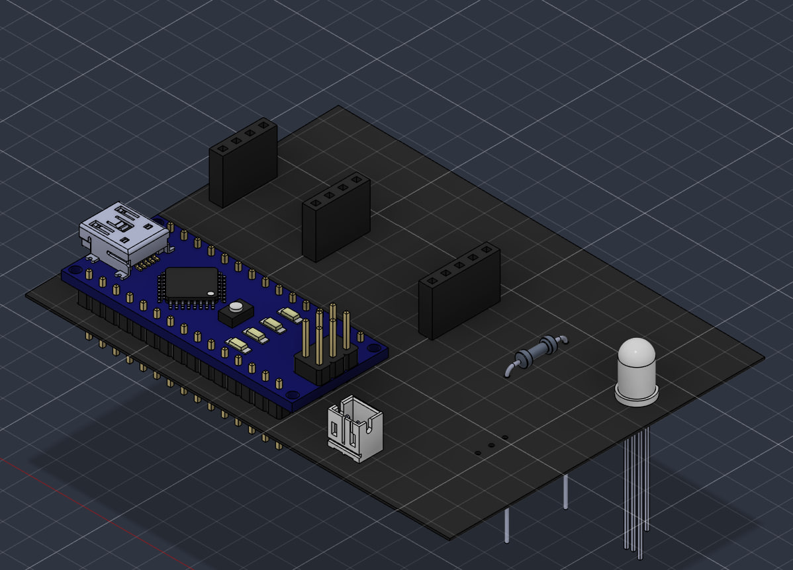
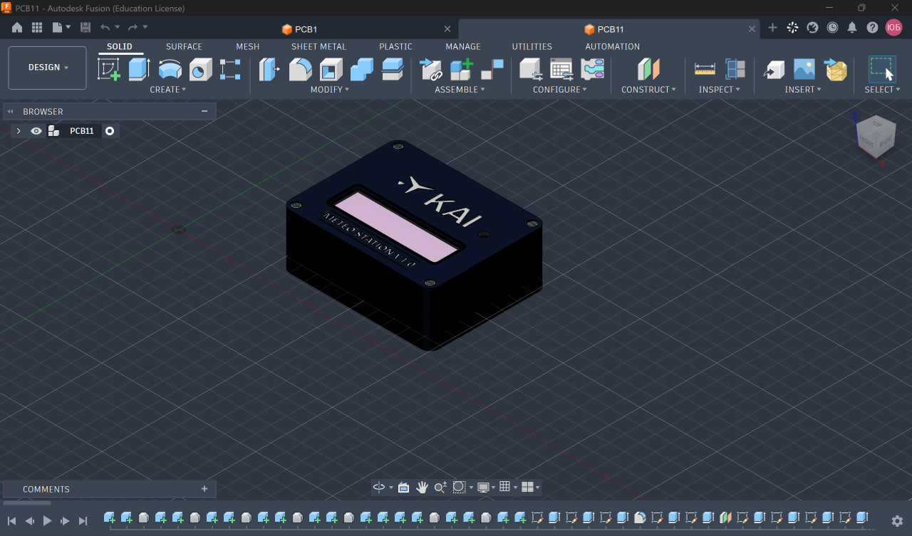
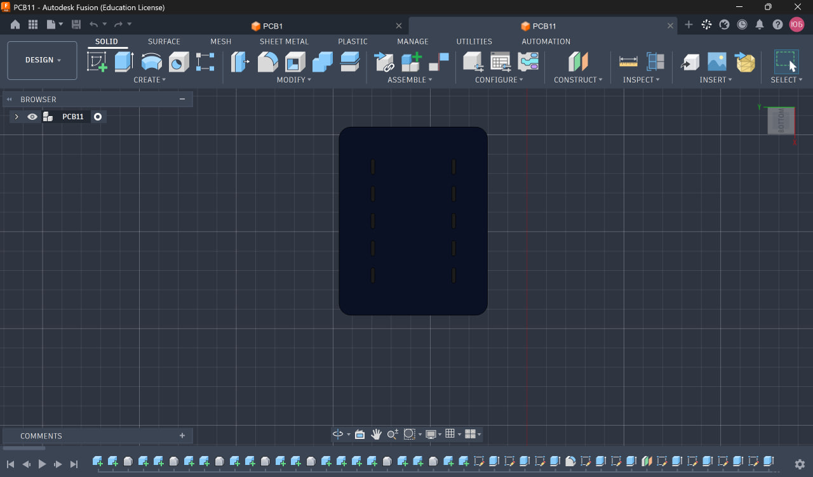
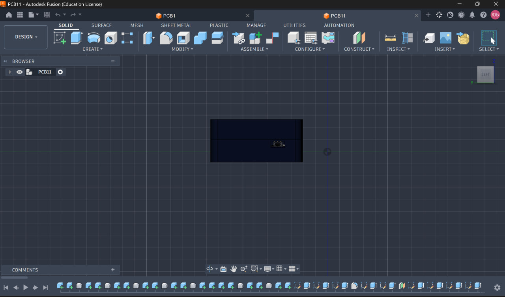

# Meteostation V1.0

## Project Overview

Development of a weather station, including electrical schematic design,
PCB layout and 3D enclosure modeling.

## 1. Electrical Schematic

  

## 2. PCB Design

### PCB Layout

  

### PCB Component Placement

  

## 3. Mechanical Design

### Internal Component Arrangement

  

### Enclosure Assembly

  

### Enclosure Views

  
  

